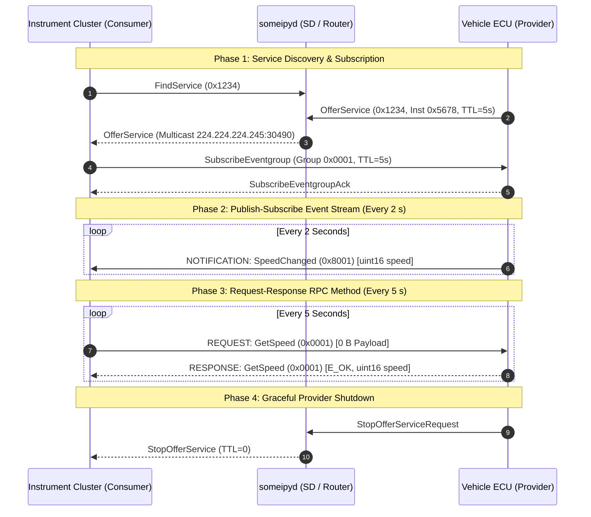

# Assignment 1: Virtual Vehicle Speed Service Using SOME/IP (`someipy`)

## 📌 Project Overview & Industry Context

Modern automotive Electronic Control Units (ECUs) increasingly transition from signal-based CAN architectures to **Service-Oriented Architectures (SOA)** over Automotive Ethernet. **SOME/IP (Scalable service-Oriented MiddlewarE over IP)** is the core automotive middleware standard enabling dynamic service discovery, remote procedure calls (RPC), and publish-subscribe event notifications across distributed ECUs.

This project implements a complete virtual automotive communication system in Python using the `someipy` library and its background daemon (`someipyd`) on Ubuntu Linux:

1. **Vehicle ECU (`vehicle_speed_service.py`):** Acts as the **Service Provider**, simulating real-time vehicle velocity ($0$ to $100\text{ km/h}$), exposing the `GetSpeed` RPC method, and publishing `SpeedChanged` events every $2\text{ seconds}$.
2. **Instrument Cluster ECU (`cluster_client.py`):** Acts as the **Service Consumer**, dynamically discovering `VehicleSpeedService` via SOME/IP-SD, subscribing to event notifications, and periodically polling `GetSpeed()`.

**Core Engineering Objectives:**

* Implement a standardized SOME/IP service interface (`VehicleSpeedService`) with shared serialization (`SpeedPayload`).
* Architect asynchronous IPC communication between Python applications and the `someipyd` daemon via `asyncio`.
* Validate **SOME/IP Service Discovery (SOME/IP-SD)** multicast traffic (`OfferService`, `StopOfferService`, `SubscribeEventgroup`) in Wireshark.
* Compare **Request-Response (Method)** and **Publish-Subscribe (Event)** communication patterns under normal and fault-injected operating conditions.

---

## 🏗️ System Architecture & Communication Flow

All components execute concurrently on Ubuntu Linux over the loopback interface (`127.0.0.1`), utilizing multicast UDP (`224.224.224.245:30490`) for Service Discovery and unicast UDP endpoints (`3000` and `3002`) for SOME/IP RPC and event payloads.

### System Architecture Diagram

```mermaid
graph LR
    subgraph Provider_Node ["Vehicle ECU (Service Provider)"]
        A[Speed Simulator<br>0-100 km/h @ 0.5 Hz] --> B[VehicleSpeedService<br>Service 0x1234 | Inst 0x5678]
        B --> C[someipy Client API]
    end

    subgraph Daemon_Layer ["SOME/IP Daemon (someipyd)"]
        D[IPC Router & SD Engine<br>Multicast 224.224.224.245:30490<br>Unicast UDP 3000 / 3002]
    end

    subgraph Consumer_Node ["Instrument Cluster (Service Consumer)"]
        E[someipy Client API] --> F[Event Callback & RPC Poller]
        F --> G[Cluster Console Display]
    end

    C <-->|Local IPC| D
    D <-->|Local IPC| E
```

### Protocol Sequence Flow (SD, Method & Event)



---

## 📡 SOME/IP Interface Specification (`vehicle_speed_interface.py`)

Both ECUs import a single source-of-truth interface definition to guarantee strict ID, version, and binary serialization alignment:

### 1. Service & Endpoint Identifiers

| Parameter | Value | Description |
| :--- | :--- | :--- |
| **Service Name** | `VehicleSpeedService` | Logical automotive service identifier |
| **Service ID** | `0x1234` | 16-bit SOME/IP Service identifier |
| **Instance ID** | `0x5678` | 16-bit Service Instance identifier |
| **Major Version** | `1` | Interface major version |
| **Transport Protocol** | `UDP` | `TransportLayerProtocol.UDP` |
| **Provider Endpoint** | `127.0.0.1:3000` | Vehicle ECU unicast socket |
| **Consumer Endpoint** | `127.0.0.1:3002` | Instrument Cluster unicast socket |
| **SD Multicast Endpoint** | `224.224.224.245:30490` | Standard SOME/IP-SD multicast group and port |

### 2. Methods & Events

| Element Name | Identifier | Type | Payload Structure | Timing / Behavior |
| :--- | :--- | :--- | :--- | :--- |
| **`GetSpeed`** | Method ID: `0x0001` | RPC Method | **Req:** Empty ($0\text{ B}$)<br>**Res:** `Uint16` ($2\text{ B}$, km/h) | Polled by Consumer every $5\text{ s}$ |
| **`SpeedChanged`** | Event ID: `0x8001`<br>Group ID: `0x0001` | Event | **Notification:** `Uint16` ($2\text{ B}$, km/h) | Published by Provider every $2\text{ s}$ |

---

## 🗂️ Repository Architecture

```text
📦 someip-python-assignment
 ┣ 📂 captures/
 ┃ ┗ 📜 assignment1-someip.pcapng       # Wireshark capture of SOME/IP-SD, RPC, and Event packets
 ┣ 📂 config/
 ┃ ┗ 📜 someipyd.json                   # Daemon configuration (SD multicast, port 30490, DEBUG logs)
 ┣ 📂 images/
 ┃ ┣ 📜 01_wireshark_someip_sd_and_rpc.png
 ┃ ┣ 📜 02_daemon_stop_and_restart_offer.png
 ┃ ┗ 📜 03_vehicle_provider_simulation.png
 ┣ 📂 src/
 ┃ ┣ 📜 vehicle_speed_interface.py      # Shared Service, Method, Event & Uint16 payload schema
 ┃ ┣ 📜 vehicle_speed_service.py        # Virtual Vehicle ECU (Service Provider)
 ┃ ┗ 📜 cluster_client.py               # Virtual Instrument Cluster ECU (Service Consumer)
 ┣ 📜 .gitignore                        # Ignores .venv/, __pycache__/, and *.pyc artifacts
 ┗ 📜 README.md                         # Project architecture, protocol specs, and execution guide
```

---

## 🚀 Build & Execution Guide

### 1. Environment Setup

```bash
git clone https://github.com/siddharth-dere/someip-python-assignment.git
cd someip-python-assignment

python3 -m venv .venv
source .venv/bin/activate
pip install --upgrade pip someipy
```

### 2. Multi-Terminal Execution Order

Open **three separate terminals** inside `~/someip-python-assignment` with `.venv` activated:

* **Terminal 1 — Start the SOME/IP Daemon:**
  ```bash
  someipyd --config config/someipyd.json
  ```
* **Terminal 2 — Start the Vehicle ECU (Service Provider):**
  ```bash
  python src/vehicle_speed_service.py
  ```
* **Terminal 3 — Start the Instrument Cluster (Service Consumer):**
  ```bash
  python src/cluster_client.py
  ```

### 3. Wireshark Packet Inspection

Capture on the Linux loopback interface (`lo`) using the following display filter:

```text
udp.port == 30490 || udp.port == 3000 || udp.port == 3002
```

---

## ⚖️ Method (`GetSpeed`) vs. Event (`SpeedChanged`) Comparison

| Characteristic | `GetSpeed` (`0x0001`) | `SpeedChanged` (`0x8001`) |
| :--- | :--- | :--- |
| **SOME/IP Mechanism** | RPC Method | Event Notification |
| **Communication Model** | Request–Response (`REQUEST` $\rightarrow$ `RESPONSE`) | Publish–Subscribe (`SUBSCRIBE` $\rightarrow$ `NOTIFICATION`) |
| **Communication Initiator** | Consumer explicitly initiates every transaction | Consumer subscribes once; Provider pushes autonomously |
| **Network Efficiency** | Requires two packets per reading (Request + Response) | Single unidirectional packet per state update |
| **Wireshark Frame Length** | Request: $8\text{ B}$ SOME/IP payload<br>Response: $10\text{ B}$ ($8\text{ B}$ header + $2\text{ B}$ `uint16`) | Notification: $10\text{ B}$ ($8\text{ B}$ header + $2\text{ B}$ `uint16`) |
| **Automotive Use Case** | On-demand diagnostic queries, configuration reads | Periodic sensor telemetry (wheel speed, engine RPM) |

---

## 🧪 Experimental Validation Findings (Task 10)

| Experiment | Test Condition | Observed Application & Network Behavior |
| :--- | :--- | :--- |
| **10.1** | Consumer started before Provider | Consumer polls `is_available()` without crashing until Provider multicasts `OfferService` (`0x1234`), triggering immediate discovery and subscription. |
| **10.2** | `GetSpeed()` RPC Execution | Consumer sends empty `REQUEST` (`0x0001`); Provider serializes `current_speed_kmph` into big-endian `uint16` bytes and returns `ReturnCode.E_OK`. |
| **10.3** | Continuous Event Notifications | Provider increments speed by $+10\text{ km/h}$ every $2\text{ s}$ and pushes `SpeedChanged` notifications without requiring per-sample requests. |
| **10.4** | Consumer Terminated (`Ctrl+C`) | Vehicle ECU continues simulating speed independently, demonstrating clean decoupling between data generation and middleware transport. |
| **10.6** | Provider Stop & Restart | Stopping Provider sends `StopOfferServiceRequest` (`TTL=0` multicast); restarting re-binds `127.0.0.1:3000` and resumes cyclic `2000 ms` offers. |